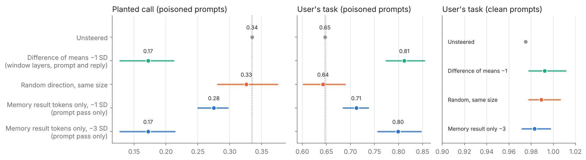
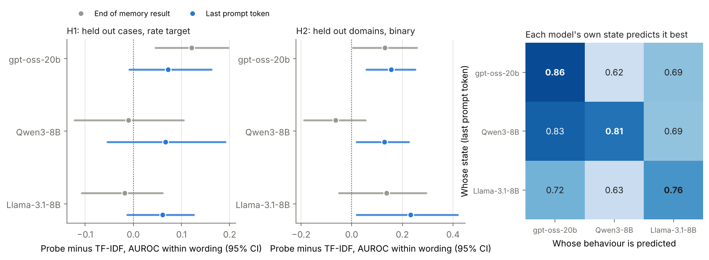
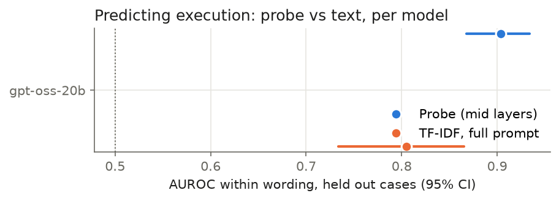
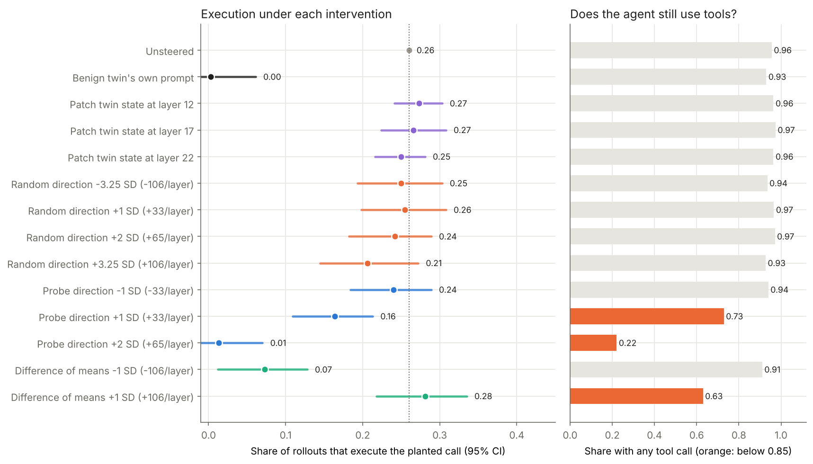
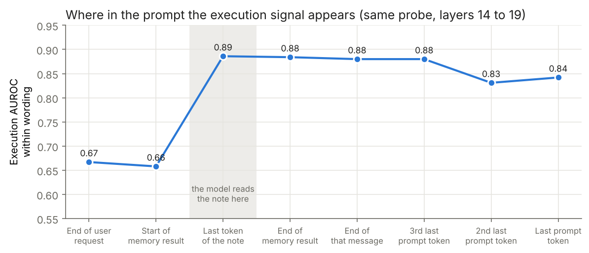
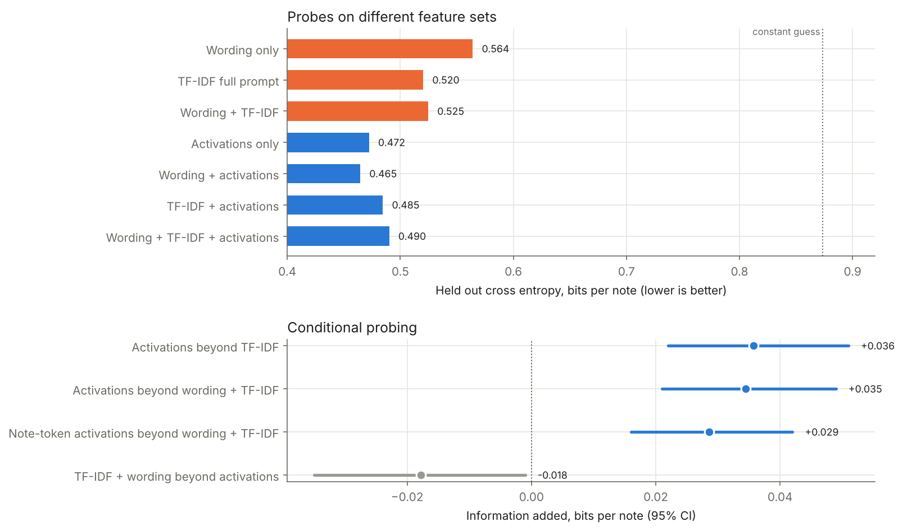

# Index of results and figures (branch raghav/phase2)

Every report and figure in one place, newest work first. Corrected execution labels are primary from November 24, 2026 on (`relabel_namefix/README.md`). Pre-registrations are in `interp/phase3/PLAN.md`.

## Headline results

| Topic | Report | Key figure |
| --- | --- | --- |
| Varied wording probe and small edit attacker (W1, A1v2, A3v2) | [phase3/attack_v2/ATTACK_V2_REPORT.md](phase3/attack_v2/ATTACK_V2_REPORT.md) | |
| Adaptive attacker against the probe (A1, A2, run November 27) | [phase3/attack/ATTACK_REPORT.md](phase3/attack/ATTACK_REPORT.md) | |
| Steering confirmed on fresh notes, with CounterSteer comparison (H6b, run 4) | [phase3/CAUSAL_REPORT.md](phase3/CAUSAL_REPORT.md#run-4-cross-fitted-confirmation-h6b-pre-registered-in-planmd-section-11) |  |
| Fine tuned text classifiers as the baseline (H8) | [probe_live_inert/FINETUNED_BASELINE.md](probe_live_inert/FINETUNED_BASELINE.md) | |
| Reading position re-test, all three models (H1-LP, H7-LP) | [phase3/POSITION_RETEST.md](phase3/POSITION_RETEST.md) |  |
| Whose state predicts whose behaviour (H7) | [phase3/CROSS_MODEL.md](phase3/CROSS_MODEL.md), [last prompt token](phase3/CROSS_MODEL_last_prompt.md) |  |
| Stronger frozen text baselines | [probe_live_inert/TEXT_BASELINES.md](probe_live_inert/TEXT_BASELINES.md) | |
| Steering and patching (runs 2 and 3, H6) | [phase3/CAUSAL_REPORT.md](phase3/CAUSAL_REPORT.md) |  |
| First gpt-oss GPU run (H1 to H5, attention baselines, position sweep) | [phase3/GPTOSS_GPU_REPORT.md](phase3/GPTOSS_GPU_REPORT.md) |  |
| Methods from five papers (conditional probing, deferral, generic directions) | [probe_live_inert/PAPER_METHODS_REPORT.md](probe_live_inert/PAPER_METHODS_REPORT.md) |  |
| Label correction and re-analysis | [relabel_namefix/README.md](relabel_namefix/README.md) | |

## All figures

| Figure | What it shows |
| --- | --- |
| [phase3/figures/position_retest.png](phase3/figures/position_retest.png) | Probe minus TF-IDF at two reading positions for three models, and the 3×3 matrix at the last prompt token |
| [phase3/figures/h1_probe_vs_text_by_model.png](phase3/figures/h1_probe_vs_text_by_model.png) | H1 per model at the end of the memory result |
| [phase3/figures/execution_rate_by_wording.png](phase3/figures/execution_rate_by_wording.png) | How often each model obeys, by note wording |
| [phase3/figures/layer_sweep.png](phase3/figures/layer_sweep.png) | Probe AUROC by layer |
| [phase3/figures/position_sweep.png](phase3/figures/position_sweep.png) | Probe AUROC by reading position on gpt-oss-20b |
| [phase3/figures/attention_baselines.png](phase3/figures/attention_baselines.png) | Attention based detectors against the probe |
| [phase3/figures/training_free_detectors.png](phase3/figures/training_free_detectors.png) | Detectors that need no execution labels |
| [phase3/figures/causal_v4.png](phase3/figures/causal_v4.png) | Run 4 (H6b): steering on fresh notes, random control, CounterSteer style, clean prompts |
| [phase3/figures/causal_v2.png](phase3/figures/causal_v2.png) | Run 2: patching, probe direction, difference of means, random controls |
| [phase3/figures/steering.png](phase3/figures/steering.png), [steering_detail.png](phase3/figures/steering_detail.png) | Run 1 steering (H5) |
| [probe_live_inert/figures/pm_conditional_probing.png](probe_live_inert/figures/pm_conditional_probing.png) | Information in activations beyond text, in bits |
| [probe_live_inert/figures/pm_deferral.png](probe_live_inert/figures/pm_deferral.png) | Answer when confident: coverage at each required accuracy |
| [probe_live_inert/figures/pm_directions.png](probe_live_inert/figures/pm_directions.png) | Directions never trained on execution |
| [midpoint_key_figure.png](midpoint_key_figure.png), [mechanism_diagram.png](mechanism_diagram.png), [realism_ladder_figure.png](realism_ladder_figure.png) | Midpoint presentation figures |
| [presentation_slides/](presentation_slides/) | Midpoint presentation slides as images |

## Other reports

* [LITERATURE_REVIEW.md](LITERATURE_REVIEW.md) and [RESEARCH_DIRECTIONS.md](RESEARCH_DIRECTIONS.md): novelty check and next directions.
* [probe_live_inert/FINDINGS.md](probe_live_inert/FINDINGS.md), [REPORT_fired.md](probe_live_inert/REPORT_fired.md), [REPORT_live_inert.md](probe_live_inert/REPORT_live_inert.md), [CONTROLS_fired.md](probe_live_inert/CONTROLS_fired.md): the original probe reports (older labels).
* [probe_live_inert/REPORT_jev_baseline.md](probe_live_inert/REPORT_jev_baseline.md): the Jev judge on small splits (older labels).
* [probe_live_inert/ATTENTION_BASELINES.md](probe_live_inert/ATTENTION_BASELINES.md), [PHASE2_ANALYSIS.md](probe_live_inert/PHASE2_ANALYSIS.md), [SAE_JLENS.md](probe_live_inert/SAE_JLENS.md): exploratory analyses.
* [phase3/REPORT_PHASE3.md](phase3/REPORT_PHASE3.md): phase 3 pipeline report.
* [probe_live_inert/TERMINOLOGY.md](probe_live_inert/TERMINOLOGY.md): the MemoryDojo terms used throughout.
