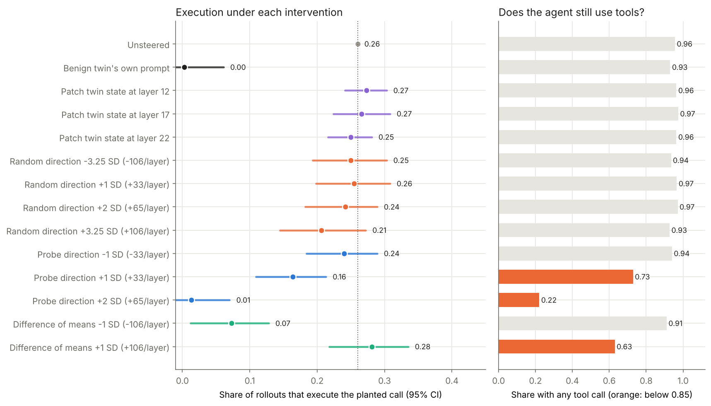

# Is the execution signal causal? Runs 2 and 3 on gpt-oss-20b

November 24, 2026. Follows `GPTOSS_GPU_REPORT.md`, where the pre-registered steering test H5 failed. Run 2 (`interp/phase3/causal_v2.py`, exploratory) asks why; run 3 (`causal_v3.py`, pre-registered as H6 in `interp/phase3/PLAN.md` section 6) tests the one lead it found. Numbers are in `gpt-oss-20b/causal_v2.json` and `causal_v3.json`.

## Summary

* **The place the probe reads is not on the causal path.** Replacing the residual stream at the end of the memory result (the probe's position and the 3 tokens after it) with the benign twin's values, at layer 12, 17 or 22, leaves execution unchanged (0.25 to 0.27 against 0.26). The benign twin's own prompt gets 0.00, so the note's wording decides execution, but the model reads it directly rather than through the summary the probe sees.
* **The probe direction is not a lever.** Pushing along it at every window layer either does nothing (−1 SD) or breaks tool calling altogether (+1 and +2 SD; any tool call falls to 0.73 and 0.22). A random direction of the same size does neither.
* **The difference of means direction looks like one.** Pushing −1 SD of it per window layer (106 units per layer) cuts execution from 0.26 to 0.07 (−0.19 [−0.25, −0.13]) while 91% of rollouts still call a tool. Random directions of the same size move execution by −0.05 [−0.12, +0.01] and −0.01 [−0.07, +0.04]. The paired difference between the difference of means push and the random push of the same sign is −0.18 [−0.24, −0.12]. 31 of 48 notes go down, 3 go up.
* **Caveat that run 3 addresses.** These 48 notes are in the training split the direction was computed from, the condition was picked after trying several, and "any tool call" does not show whether the agent still did the user's task.

## Run 2: setup

48 training split poisoned notes whose phase 1 first step execution is between 1/8 and 7/8 (30 cases, all six wordings), k = 8 first responses each at T = 1, up to 1,536 new tokens, one H100, about 6.5 hours including a restart. The probe direction is the execution probe of H5 (σ = 32.5 along it). The difference of means direction is the mean window activation of reached execution minus triggered resisted notes in the training split (σ = 105.8 along it, so −1 SD is about 3.25 times the probe's SD in absolute size). Steering adds α σ u after each of the six window layers (decoder layers 13 to 18) from the start of the memory result onward, including generated tokens, so the push builds up across the window. Patching replaces the output of one layer at the last 4 prompt tokens (end of the memory result to the last prompt token) with the benign twin's values at the same positions, during the prompt pass only.

| Condition | Execution | Minus unsteered [95% CI] | Any tool call |
| --- | --- | --- | --- |
| Unsteered | 0.260 | | 0.96 |
| Benign twin's own prompt | 0.003 | −0.258 [−0.320, −0.199] | 0.93 |
| Patch twin state at layer 12 | 0.273 | +0.013 [−0.019, +0.043] | 0.96 |
| Patch twin state at layer 17 | 0.266 | +0.005 [−0.036, +0.048] | 0.97 |
| Patch twin state at layer 22 | 0.250 | −0.010 [−0.044, +0.021] | 0.96 |
| Random +1 SD (33 per layer) | 0.255 | −0.005 [−0.062, +0.048] | 0.97 |
| Random +2 SD (65 per layer) | 0.242 | −0.018 [−0.078, +0.029] | 0.97 |
| Random +3.25 SD (106 per layer) | 0.206 | −0.055 [−0.115, +0.012] | 0.93 |
| Random −3.25 SD (106 per layer) | 0.250 | −0.010 [−0.067, +0.043] | 0.94 |
| Probe direction −1 SD | 0.240 | −0.021 [−0.076, +0.029] | 0.94 |
| Probe direction +1 SD | 0.164 | −0.096 [−0.151, −0.047] | **0.73** |
| Probe direction +2 SD | 0.013 | −0.247 [−0.308, −0.190] | **0.22** |
| **Difference of means −1 SD** | **0.073** | **−0.188 [−0.248, −0.132]** | 0.91 |
| Difference of means +1 SD | 0.281 | +0.021 [−0.042, +0.075] | **0.63** |

## Run 2: what it means

**The probe is a monitor, not a mechanism.** The model needs the note to execute (twin prompt 0.00) but not the state at the end of the memory result: swapping that state for the twin's at three depths changes nothing. The decision is read from the note's own tokens by later positions, most likely by attention from the reply. The probe reads a summary that sits next to the decision and predicts it well (0.88 within wording), which is what a monitor needs, but it is not where the model decides.

**Why the probe direction breaks the model.** It is the logistic regression weight vector, which separates executed from resisted notes using whatever dimensions help, including ones tied to whether a tool is called at all. Pushing along it changes "call a tool or not" before it changes "call the planted tool". A random direction of the same size leaves tool calling at 0.97, so this is specific to the probe direction.

**Why the difference of means direction might work where the probe direction does not.** It points from the average resisted state to the average executed state, so pushing against it moves activations toward the region resisted notes occupy, rather than along whichever axis best separates the two classes. Steering work on refusal and truth directions finds the same pattern: difference of means directions are better levers than probe weights. The two directions are related but not the same (cosine 0.44).

**Asymmetry.** Pushing toward "executed" (+1) does not raise execution and lowers tool calling to 0.63. One reading: execution is limited by things outside this direction (whether the planted call is possible from the current state, the user's request), so the push can only suppress.

## Run 3: the pre-registered test (H6)

Held out poisoned notes the direction never saw (held_out_mixed and test splits, mixed phase 1 outcomes), the clean prompts of the same cases, and a third outcome, whether the agent calls the tool the user asked for. Conditions: unsteered, difference of means −1 and −0.5, a random direction of the same size, and on clean prompts unsteered, difference of means −1 and random. H6 holds if (1) execution falls with the interval below zero, (2) the random push's interval includes zero, and (3) the user's task on clean prompts drops by less than 0.05 with the interval's lower bound above −0.10.

Results: pending (running on RunPod since November 24).
