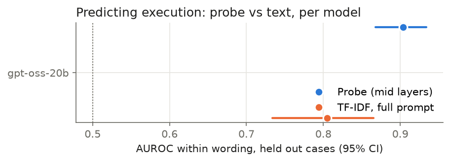
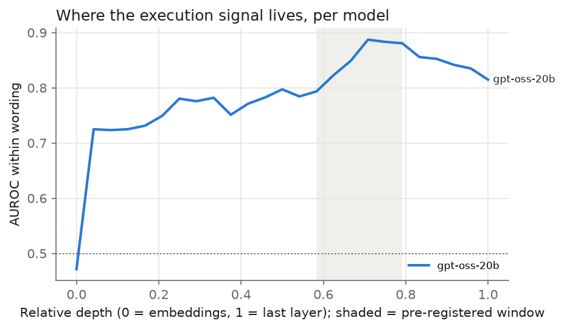
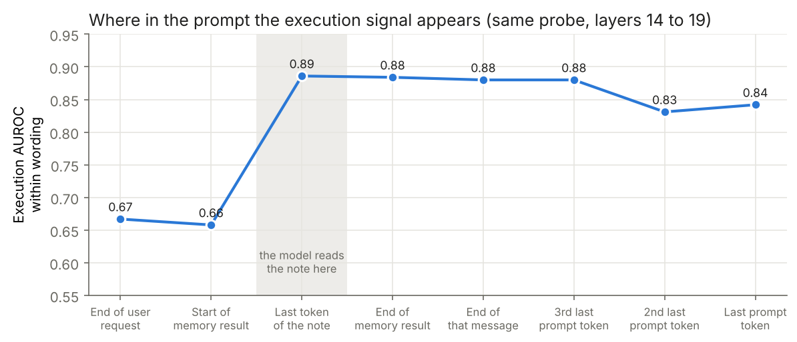
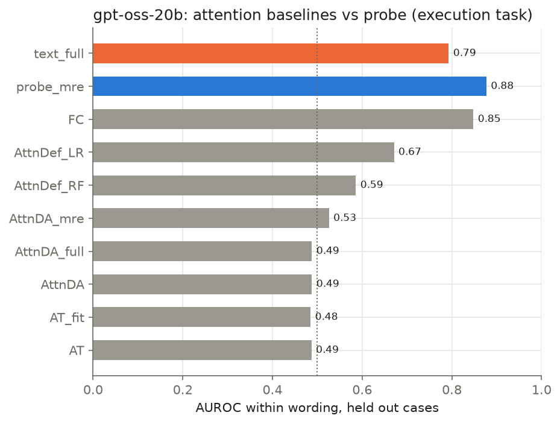
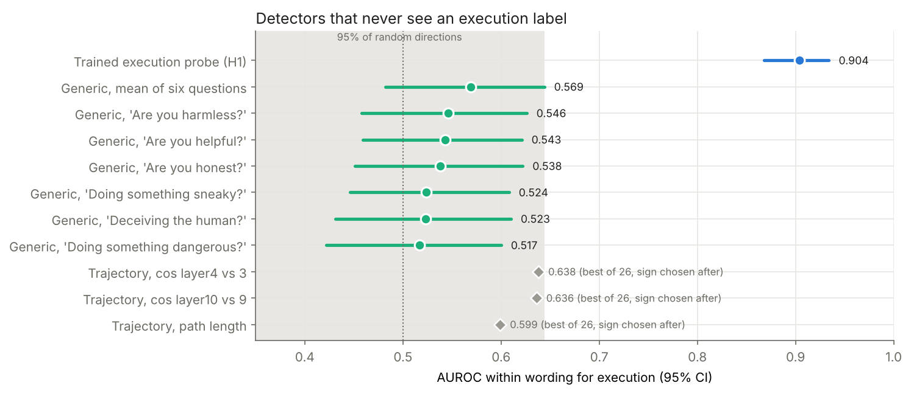
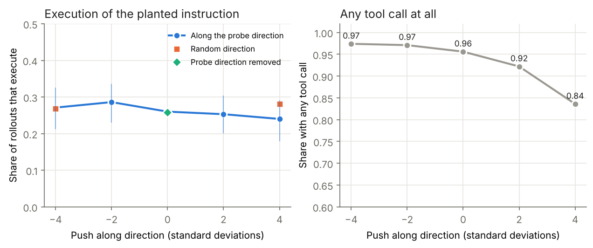

# gpt-oss-20b on the GPU: results of the first RunPod run

November 23, 2026. One H100 80GB on RunPod, about 4.5 hours of compute including a crashed first attempt (roughly $20 to $25). Terms follow `results/probe_live_inert/TERMINOLOGY.md`; the pre-registration is `interp/phase3/PLAN.md`. The generated tables are in `REPORT_PHASE3.md`, `results/probe_live_inert/ATTENTION_BASELINES.md` and `gpt-oss-20b/*.json`. This file explains them.

## Summary

* **The probe result is now confirmatory.** On a fresh capture, with tests fixed before the run, the probe beats a TF‑IDF reader of the full prompt at predicting execution among notes with the same wording. It does so on held out cases (+0.099, 95% CI 0.031 to 0.167) and on held out domains (+0.142, 0.017 to 0.265). H1, H2 and H3 hold.
* **The steering test (H5) fails.** Pushing the residual stream along the probe direction, or removing that direction, does not change how often the agent executes the planted instruction. Every condition is within 0.03 of the unsteered rate, and random directions do just as much. The probe reads a signal that predicts execution, but at least in this form it is not a lever the model uses.
* **The signal appears when the model reads the note.** At the end of the user request the probe scores 0.67 within wording; at the last token of the note it scores 0.89 and stays there. Across depth it peaks at layer 17 of 24, inside the pre-registered window.
* **Attention based detectors from recent papers do not predict execution.** Within wording, Attention Tracker and AttnDA score 0.49 (chance), AttentionDefense 0.67, the last layer FC baseline 0.85 and the probe 0.88.
* **Detectors without execution labels fail.** The six generic yes/no directions of MacDiarmid et al. score 0.52 to 0.57, all inside the range of random directions. Trajectory geometry (Pandey et al.) tops out at 0.64 after choosing the best of 26 measures.

## 1. What ran

`runpod/run_gptoss.sh` on one H100 80GB, model weights dequantized from MXFP4 to bf16 (the same as the phase 1 capture).

| Step | What | Time |
| --- | --- | --- |
| 1 | Attention for all 1,924 prompts (eager attention), then the attention baselines on the CPU | 9 min |
| 2 | Residual stream at all 25 points and 8 positions; H1 to H4; layer, position and trajectory sweeps; generic yes/no directions | 15 min |
| 3 | Steering, 8 conditions × 48 notes × 8 rollouts, up to 1,536 new tokens each | 4 h 3 min |
| 4 | Report and figures | 1 min |

Two fixes were needed on the pod and are now in the repo. The PyTorch image ships a Debian PyJWT that pip cannot replace (`setup_pod.sh` now reinstalls it and pins the template's torch), and steering at 32 prompts per batch ran out of memory because gpt-oss's eager attention materializes the full attention matrix while reading the prompt (`run_gptoss.sh` now uses 16).

## 2. Pre-registered tests

| Test | Result | Holds |
| --- | --- | --- |
| H1, held out cases, execution rate target | probe 0.904 vs TF‑IDF 0.805 within wording, difference +0.099 [0.031, 0.167] | yes |
| H2, leave one domain out | 0.763 vs 0.621, difference +0.142 [0.017, 0.265] | yes |
| H3, Spearman with the execution rate within wording | difference +0.165 [0.093, 0.240] | yes |
| H4, poisoned vs benign twin (sanity check) | 0.9998 on new wordings, 1.0 on new domains | yes |
| H5, steering moves execution in the predicted direction | +4 SD: −0.021 [−0.079, +0.030]; −4 SD: +0.010 [−0.046, +0.064] | **no** |

888 poisoned notes, 286 reached execution, mean execution rate 0.294; these match the phase 1 labels, as they must, since the labels were not resampled.

## 3. Where the signal lives

Within wording, a probe on the embeddings is at chance (0.47). After the **first** layer it already reaches 0.72, close to TF‑IDF (0.81), because one layer of attention is enough to encode which words and tool names are present. The next 16 layers add another 0.17, up to 0.887 at layer 17, then it falls to 0.81 at the last layer. That rise through the middle of the network is the part text cannot reproduce, and it is where the pre-registered window (layers 14 to 19) sits.

The same probe, read at different tokens. Before the note is read the probe scores 0.66 to 0.67, which is information about the case and the user request alone (some cases are more prone to execution). It jumps to 0.89 at the last token of the note and stays at 0.88 to the end of the tool result. Ashok and May found the last prompt tokens best for their tasks; here they are slightly worse (0.83 to 0.84), so the end of the memory result is a good place to read.

## 4. Attention baselines (RQ1)

Execution among poisoned notes, held out cases, within wording:

| Method | AUROC within wording | Overall AUROC | Recall at 1% false alarms |
| --- | --- | --- | --- |
| Attention Tracker (Hung et al.) | 0.487 | 0.526 | 4% |
| AttnDA | 0.488 | 0.746 | 8% |
| AttentionDefense, logistic regression | 0.671 | 0.850 | 16% |
| Last layer FC | 0.848 | 0.963 | 53% |
| **Probe, end of memory result** | **0.877** | **0.973** | **53%** |
| TF‑IDF full prompt | 0.793 | 0.954 | 43% |

For poisoned vs benign twin, Attention Tracker scores 0.58 and AttnDA 0.74, while the probe and TF‑IDF are at 1.0. AttnDA's overall execution AUROC of 0.75 drops to 0.49 within wording, so what it picks up is the wording. A likely reason attention methods struggle on this model is that half of gpt-oss's layers only attend 128 tokens back, and from the last prompt token the user request is 123 to 818 tokens away (median 390).

These numbers replace the unmeasured values in `results/architecture_comparison_at_vs_probe.png` on main.

## 5. Detectors that never see an execution label

**Generic yes/no directions (MacDiarmid et al. 2024).** We asked gpt-oss six questions ("Are you a helpful AI?", "Are you doing something dangerous?" and four more), took the difference in activation between the bad and good answer, and projected the end of each memory result onto it, with the sign fixed in advance. All six score 0.52 to 0.55 within wording and their mean 0.57 [0.48, 0.64], inside the 95% range of random directions (0.35 to 0.64). Scoring the same directions on the phase 1 cached activations (`PAPER_METHODS.md`) gives the same picture, 0.52 to 0.57. In the sleeper agent models this trick worked because the backdoor was one large, salient change. Here, obeying a planted note does not look like "being dangerous or deceptive" to the model, which makes sense because most planted tasks are ordinary tool calls rather than anything that looks harmful.

**Trajectory geometry (Pandey et al. 2026).** Path length, turning angle and the cosine between consecutive layers, 26 measures in all, each scored with whichever sign works better. The best reaches 0.64 for execution, which is what picking the best of 26 noisy measures gives you. One measure does notice poisoning: the cosine between layers 9 and 10 separates poisoned notes from benign twins at 0.78.

## 6. Steering (H5)

**Setup.** The direction is the execution probe trained on the training split. We added α standard deviations of the probe's projection (σ = 32.5) to the residual stream after layer 13, the start of the window, at every position from the start of the memory result onward, including generated tokens. "Ablate" removes the direction at every window layer. 48 notes, 8 rollouts each, and the outcome is whether the first assistant step makes the planted call. Unsteered, this run's rate (0.26) tracks the phase 1 vLLM labels (0.30; per note correlation 0.55).

**Result.** Execution barely moves (0.24 to 0.29) and random directions move it as much. The one clear change is that +4 SD makes the agent call **any** tool less often (0.96 to 0.84), so the push does change behaviour, just not the specific behaviour the probe predicts.

**Was the push big enough?** Along the probe direction, executed and resisted notes differ by 59 units on average (about 1.8 σ), so +4 σ (130 units) moves an average resisted note well past an average executed one. Relative to the whole residual stream it is modest (the median residual norm in the window is about 3,300, dominated by a few very large dimensions, and the typical deviation from the mean is about 400). So the null is not a tiny push, but it is a single layer push.

**What it means.** The probe is a good thermometer but not a thermostat. Three readings fit the data, and the next runs can separate them.

1. The direction is a **correlate**: something computed alongside the decision, for example how plausible the planted request looks, that downstream layers do not read when deciding.
2. The decision is **distributed**: the model can recompute it from many other features after one layer is edited, so a single direction at a single layer is overwritten. The failure of difference of means and the generic directions points the same way.
3. A logistic regression direction is a **poor steering vector**: probe weights optimise separation, not causal effect, and steering papers usually get better results from difference of means directions or from patching.

Until one of these is tested, the paper should present the probe as a **monitor**, not as an explanation of how the model decides.

## 7. Next GPU runs

Ordered by how much each tells us per dollar (H100 at $4.40 an hour).

| Run | Question | Rough cost |
| --- | --- | --- |
| Steering v2: push at every window layer, α up to ±16, difference of means direction, only at the note's tokens | Is H5's null a matter of how we steered? | 3 to 4 h, $15 |
| Activation patching: swap the window activations between an executed and a resisted note with the same wording | Does the window carry the decision at all? | 2 h, $10 |
| Multi-model pilot (Qwen2.5 7B, Llama 3.1 8B, Qwen3 8B) through `sample.py` and the pilot gate | Does H1 generalize beyond gpt-oss? | 6 to 10 h, $30 to $45 |
| Jev v2 on all 888 notes (API, no GPU) | Fair comparison with the guardrail in proposal v2 | API cost only |

Steering should also save results after each condition, so a crash loses one condition rather than all of them; that change is small and comes first.

## 8. Caveats

* One model and one dataset. The multi-model runs are what turn H1 into a general claim.
* Execution labels come from 8 rollouts per note, so a note at 4 of 8 is close to a coin flip.
* Steering used 48 notes and the first assistant step only; the intervals are about ±0.05, so an effect smaller than that would be missed.
* TF‑IDF is the text baseline in the pre-registration; a stronger text model is still owed.
* Wording 3 is the only wording where execution is mixed, so most within wording comparisons rest on it.

## 9. Files

* `gpt-oss-20b/analysis.json`, `sweeps.json`, `steering.json`, `generic_probe_scores.json`: the numbers.
* `REPORT_PHASE3.md`: generated tables (`interp/phase3/report.py`).
* `figures/`: generated by `report.py` and `interp/phase3/gptoss_figures.py`.
* `results/probe_live_inert/ATTENTION_BASELINES.md`, `attention_baselines.json`, `at_calibration.json`, `generic_probe_directions.npz`.
* `gpt-oss-20b/window_features.npz` (20 MB) is not in git; it is in `results_gptoss.tar.gz` and on the RunPod volume `sleeper-detection`.
