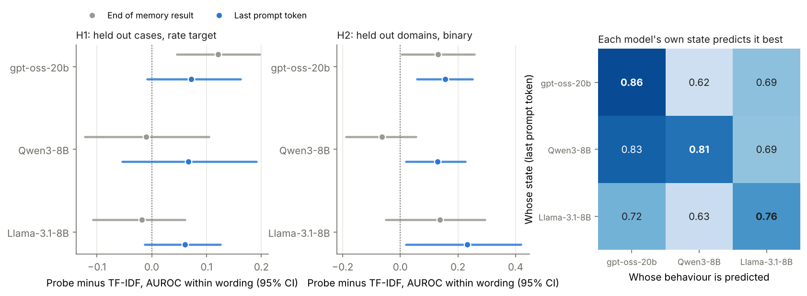

# Reading position re-test: all three models at the last prompt token

November 26, 2026. Pre-registered in `interp/phase3/PLAN.md` section 9 before any of these activations existed. Run with `runpod/run_recapture.sh` (one GPU, 29 minutes, no new sampling: the behaviour labels are the ones already in the repo, corrected labels for gpt-oss). Numbers are in `results/phase3/<model>/analysis_last_prompt.json` and `results/phase3/cross_model_last_prompt.json`; figure from `interp/phase3/position_retest_figure.py`.

**Status of this analysis.** The last prompt token was chosen after the exploratory position sweeps of Qwen3-8B and Llama-3.1-8B pointed to it, on the same notes. The re-test is therefore not independent of the data that suggested it and is reported as a secondary, position corrected analysis. H1 at the end of the memory result remains the primary result. Any model added from now on is read at the last prompt token by default, which makes the next model a clean test.

## H1-LP and H2: does the probe beat the text of the prompt?

Probe minus TF-IDF on the full prompt, AUROC within wording, 95% interval over 1,000 case resamples. A test holds if the interval is above zero.

| Model | Reached execution | Test | End of memory result | Last prompt token |
| --- | --- | --- | --- | --- |
| gpt-oss-20b | 297 | H1 (held out cases, rate target) | **+0.121 [+0.046, +0.197]** | +0.072 [−0.008, +0.162] |
| | | H2 (held out domains, binary) | **+0.131 [+0.004, +0.257]** | **+0.156 [+0.057, +0.250]** |
| Qwen3-8B | 128 | H1 | −0.010 [−0.122, +0.104] | +0.067 [−0.054, +0.191] |
| | | H2 | −0.064 [−0.189, +0.054] | **+0.129 [+0.019, +0.225]** |
| Llama-3.1-8B | 68 | H1 | −0.018 [−0.107, +0.061] | +0.061 [−0.013, +0.125] |
| | | H2 | +0.137 [−0.051, +0.294] | **+0.232 [+0.020, +0.418]** |

Bold marks an interval above zero. gpt-oss at the end of the memory result uses the corrected labels (`results/relabel_namefix/phase3_analysis.json`).

**H1-LP fails for all three models**, each narrowly. The estimates are close to each other (+0.06 to +0.07) and every interval includes zero. For Qwen and Llama the estimate moves from about zero to about +0.06; for gpt-oss it falls from +0.12 to +0.07, so the end of the memory result stays the better position for gpt-oss.

**H2 holds for all three models at the last prompt token.** When whole domains are held out, the probe beats the text classifier on every model, and on Qwen and Llama this is new (neither held at the end of the memory result). Held out domains is the harder generalisation test for the text baseline, whose vocabulary does not transfer to new domains, which is likely why the gap is larger there.

The rank correlation with the execution rate (the secondary H1 statistic) is above zero at the last prompt token for gpt-oss (+0.115 [+0.035, +0.201]) and Qwen (+0.185 [+0.089, +0.285]) but not Llama (+0.046 [−0.043, +0.135]).

## H7-LP: whose state predicts whose behaviour?

AUROC within wording, every state read at the last prompt token.

| Features | predicts gpt-oss-20b | predicts Qwen3-8B | predicts Llama-3.1-8B |
| --- | --- | --- | --- |
| TF-IDF of the prompt | 0.786 | 0.727 | 0.711 |
| gpt-oss-20b's state | **0.863** | 0.624 | 0.695 |
| Qwen3-8B's state | 0.834 | **0.810** | 0.691 |
| Llama-3.1-8B's state | 0.717 | 0.630 | **0.762** |

**H7-LP holds in all six ordered pairs.** For each model's behaviour, its own state adds information beyond each other model's state (conditional probing interval above zero) and the reverse does not. At the end of the memory result this held in five of six pairs; the one failure (Llama's behaviour against gpt-oss's state) now holds, with Llama's own state adding +0.019 bits [+0.009, +0.032] and +0.070 AUROC [+0.029, +0.112] beyond gpt-oss's. Full conditional probing table in `CROSS_MODEL_last_prompt.md`.

Each column's best row is the model itself. This is the cleanest form of the self knowledge result so far: read at the same position, a model's own activations predict its own obedience better than another model reading the identical prompt, and the advantage only runs one way.

## What this changes in the story

1. **The probe's advantage over text is real but modest at a shared position.** About +0.06 to +0.07 AUROC on all three models under held out cases (not significant per model), and +0.13 to +0.23 under held out domains (significant on all three).
2. **gpt-oss is special in where, not whether.** It forms a readable forecast of its own obedience already at the end of the memory result; the smaller models only do so at the end of the prompt.
3. **Self knowledge generalises across models.** H7 now holds for every pair.
4. **Power is the limit for H1.** Qwen and Llama reach execution on 128 and 68 notes against 297 for gpt-oss. A model that obeys more often, or more notes per case, is the most direct way to settle H1 on the smaller models.

## Not done, on purpose

A pooled test across the three models would likely put H1-LP above zero, but it was not pre-registered, so it is not reported as a result.
