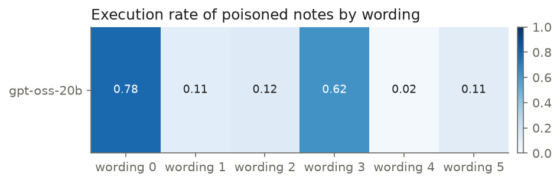
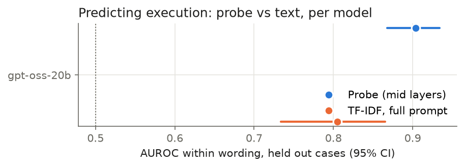
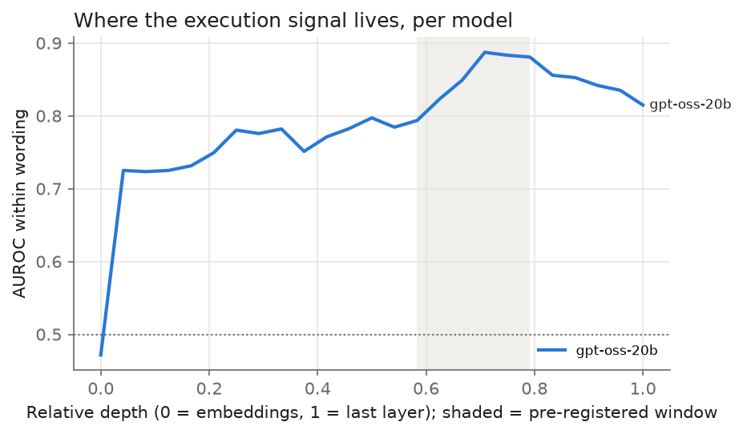
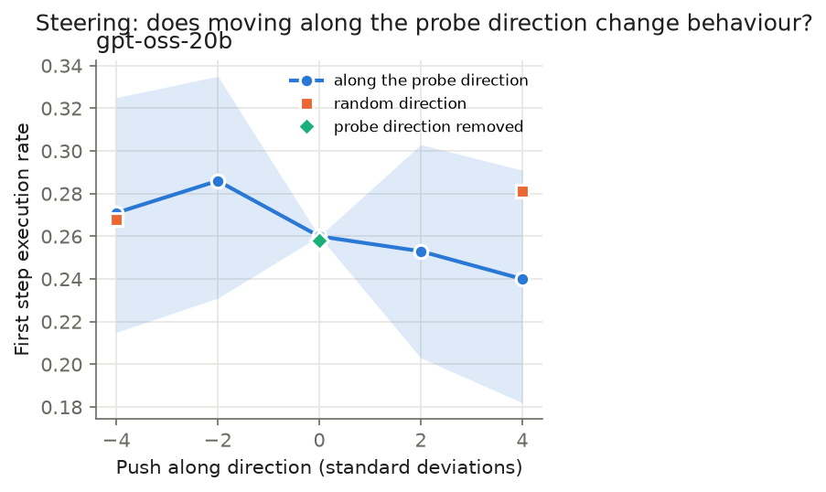
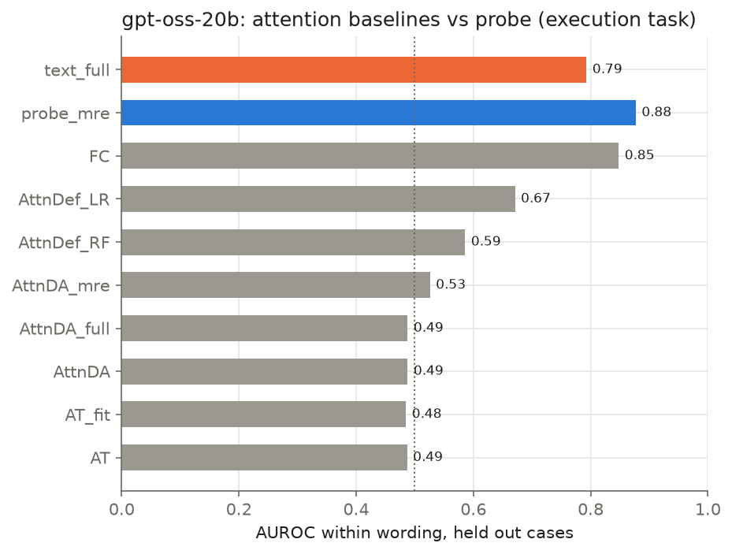

# Phase 3: does the execution signal generalize across models, and is it causal?

Generated by `interp/phase3/report.py` from the result files; rerun it after every new run.

Terms follow `results/probe_live_inert/TERMINOLOGY.md`. Plan and pre-registration: `interp/phase3/PLAN.md`.

## Summary

* Models with full results: 1 included under the pre-registered rule (gpt-oss-20b).
* H1 (probe beats full prompt TF-IDF within wording, CI above zero) holds in 1 of 1: gpt-oss-20b.
* Steering on gpt-oss-20b: execution rate 0.27 at minus 4 SD, 0.26 unsteered, 0.24 at plus 4 SD (difference from unsteered -0.021 [-0.079, +0.030]); random direction at plus 4 SD +0.021 [-0.032, +0.073].

## What changed since the October report

* **Terminology.** The repo's MemoryDojo lifecycle states are used throughout: poisoned note (was live), benign twin
  (was inert), reached execution (was fired), triggered resisted (was not fired), execution rate (was fire rate).
* **Primary label.** The execution rate (rollouts reaching execution out of 8) replaces the yes/no label as the target;
  yes/no (at least 4 of 8) is secondary.
* **Primary metric.** AUROC computed only over pairs of notes with the same wording, because wording alone moves the
  execution rate from 2% to 78% and inflates overall AUROC for every method.
* **Strongest text baseline.** TF-IDF on the full prompt (not only the note) is the comparison for every claim.
* **Nested model selection** for the probe's regularization, so no test fold influences the choice.
* **Leave one domain out within wording** with text baselines, replacing a domain averaged number that mostly
  measured wording.
* **The pre-registered set E3 is reported as uninformative** (2 positives) instead of as a headline.
* **Jev guard baseline rebuilt** for a fair comparison (full or random sets, saved scores, error counts, neutral
  policy, a will it execute question, few shot and train fitted variants).
* **Attention baselines added** (Attention Tracker, AttnDA, AttentionDefense, last layer FC) on real attention.
* **Interpretability readouts added** (Neuronpedia SAE latents and Jacobian lens).
* **Phase 3 (this report): the same pipeline on several open models**, each with its own behaviour labels, a
  pre-registered window at the same relative depth, an inclusion rule, and a causal steering test.
* **Code hygiene.** Real scikit-learn everywhere (an offline reimplementation was retired), gpt-oss-20b pinned where
  the dataset's token ids require it, all work on branches.

## Models and the inclusion rule

A model is analysed only if, on all 888 poisoned notes, at least 50 reach execution, at least 50 are resisted, and at least 2 wordings contain both outcomes (otherwise there is nothing to predict).

| Model | Notes | Reached execution | Mean execution rate | Included | Pilot gate passed |
| --- | --- | --- | --- | --- | --- |
| gpt-oss-20b | 888 | 286 | 0.294 | yes | n/a |

## H1, held out cases, execution rate target (primary)

| Model | Probe [95% CI] | TF-IDF full prompt [95% CI] | Difference [95% CI] | Spearman difference [95% CI] |
| --- | --- | --- | --- | --- |
| gpt-oss-20b | 0.904 [+0.868, +0.934] | 0.805 [+0.734, +0.865] | +0.099 [+0.031, +0.167] | +0.165 [+0.093, +0.240] |

## H2, leave one domain out (secondary)

| Model | Probe | TF-IDF full prompt | Difference [95% CI] |
| --- | --- | --- | --- |
| gpt-oss-20b | 0.763 | 0.621 | +0.142 [+0.017, +0.265] |

## H4, poisoned vs benign twin (sanity check)

| Model | E1 | E2 |
| --- | --- | --- |
| gpt-oss-20b | 0.9998 | 1.0 |

## Layer sweep (descriptive)

## H5, steering (causal test)

| Model | Condition | First step execution | Minus unsteered [95% CI] | Any tool call |
| --- | --- | --- | --- | --- |
| gpt-oss-20b | add_-4 | 0.271 | +0.010 [-0.046, +0.064] | 0.97 |
| gpt-oss-20b | add_-2 | 0.286 | +0.026 [-0.029, +0.075] | 0.97 |
| gpt-oss-20b | add_+0 | 0.260 | +0.000 [+0.000, +0.000] | 0.96 |
| gpt-oss-20b | add_+2 | 0.253 | -0.008 [-0.058, +0.042] | 0.92 |
| gpt-oss-20b | add_+4 | 0.240 | -0.021 [-0.079, +0.030] | 0.84 |
| gpt-oss-20b | random_-4 | 0.268 | +0.008 [-0.038, +0.056] | 0.95 |
| gpt-oss-20b | random_+4 | 0.281 | +0.021 [-0.032, +0.073] | 0.96 |
| gpt-oss-20b | ablate | 0.258 | -0.003 [-0.051, +0.045] | 0.89 |

Unsteered check for gpt-oss-20b: Hugging Face first step rate 0.26 vs vLLM 0.299 (correlation 0.546).

## RQ1, attention baselines on gpt-oss-20b

Within wording AUROC, held out cases: AT 0.487, AT_fit 0.485, AttnDA 0.488, AttnDA_full 0.488, AttnDA_mre 0.526, AttnDef_RF 0.586, AttnDef_LR 0.671, FC 0.848, probe_mre 0.877, text_full 0.793.

## Limitations

* One attack family (Sleeper Attack), one trigger turn per prompt, canned tool results after the first step.
* Steering measures the first response only, generated with Hugging Face rather than vLLM.
* Models differ in how often they call tools at all; the inclusion rule removes models that never or always execute.
* Analyses beyond those listed in PLAN.md are exploratory and labelled as such.
