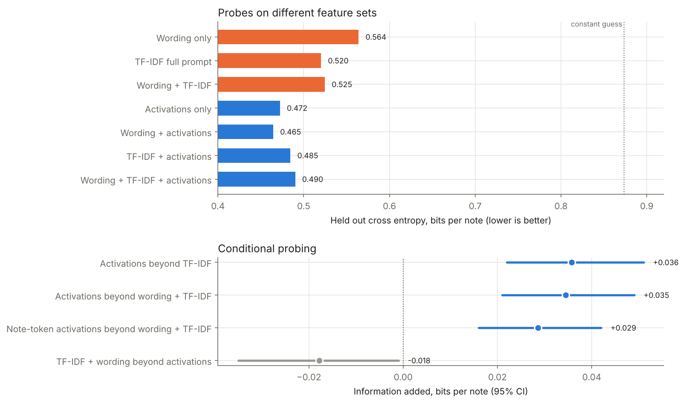
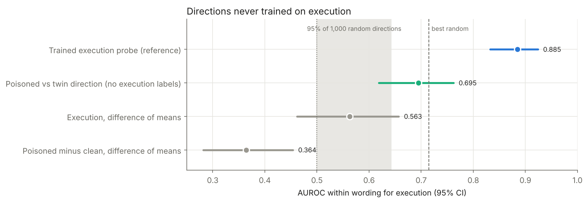
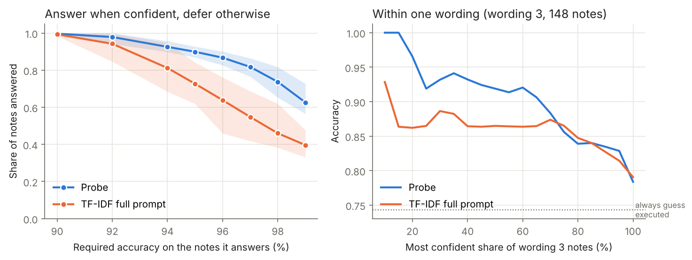

# What five papers tell us about the execution probe

Report on the CPU part of the paper methods work, November 22, 2026. Model gpt-oss-20b, dataset behavior_v1, MemoryDojo terminology (see `TERMINOLOGY.md`). Numbers come from `paper_methods.json` and `pm_curves.json`; the tables in `PAPER_METHODS.md` are generated by the same script.

## Summary

We took one method from each of five papers and applied it to the question this project keeps returning to: **does the probe read something about execution that the prompt text alone does not give away?** Three of the five methods run on the activations we already cached, so they ran on the CPU. The other two, and one extra control from the third paper, need a GPU and are packaged for RunPod.

1. **Conditional probing (Hewitt et al. 2021) says yes.** After a model is given the wording of the note and a TF‑IDF bag of words over the whole prompt, adding the activations still cuts held out cross entropy by 0.035 bits per note (95% CI 0.021 to 0.049) and raises AUROC within wording by 0.089 (0.046 to 0.130). Going the other way, text adds nothing once the activations are in.
2. **A direction never trained on execution partly finds it (MacDiarmid et al. 2024).** The direction that separates poisoned notes from benign twins ranks notes by execution at 0.695 within wording. That beats 95% of 1,000 random directions but not the single best one (0.707), so this is weak evidence. A simple difference of means fails (0.563), unlike in the Anthropic sleeper agent work.
3. **Confidence based deferral favours the probe (Ashok and May 2025).** If the monitor must be right 98% of the time on the notes it answers, the probe can answer 74% of notes and the text baseline only 46%.
4. **Trajectory geometry (Pandey et al. 2026), the generic yes/no probe (MacDiarmid et al.) and function vectors (Todd et al. 2024)** need new forward passes. The first two are in `runpod/run_gptoss.sh`; function vectors come after.

All three CPU results are **exploratory**. Section 6 explains what that means and how they become confirmatory.

## 1. Setup in one paragraph

Each of the 148 cases has six wordings of a planted memory note. The poisoned note asks the agent to do something the user never asked for; its benign twin carries the same wording with a harmless request. We sampled every poisoned note 8 times and call it **reached execution** when the agent made the planted call in at least 4 of 8 rollouts. The probe is a logistic regression on the residual stream at the last token of the memory tool result, averaged over layers 14 to 19 of 24. Every probe here is trained on four fifths of the cases and scored on the held out fifth, so no case appears on both sides.

Why within wording matters: execution rates by wording are 0.92, 0.07, 0.10, 0.74, 0.01 and 0.10. A detector that only learned the wording would score 0.91 overall AUROC and still be useless for telling apart two notes with the same wording. So we report **AUROC within wording**, which only compares notes that share a wording, and pool across the six. A perfect detector scores 1 and a coin scores 0.5.

## 2. Conditional probing (Hewitt, Ethayarajh, Liang and Manning 2021)

**The paper.** A probe's accuracy mixes two things, what the representation encodes and what the probe can recover from easier inputs. Hewitt et al. propose measuring the information a representation adds beyond a baseline B, as the drop in cross entropy from a probe on [B; representation] versus a probe on B alone.

**Our adaptation.** Target is the execution rate (fraction of 8 rollouts), fitted with binomial sample weights so a note executed 7 of 8 times counts as 7 positives and 1 negative. Baselines are the wording (six way one hot), the TF‑IDF over the full prompt, and both together. Regularisation is picked inside each training fold. Intervals come from resampling cases 1,000 times.



| Feature set | Cross entropy, bits per note | AUROC within wording |
| --- | --- | --- |
| Constant guess | 0.874 | 0.5 |
| Wording only | 0.564 | not meaningful (see note) |
| TF‑IDF full prompt | 0.520 | 0.811 |
| Wording and TF‑IDF | 0.525 | 0.793 |
| **Activations only** | **0.472** | **0.908** |
| Wording and activations | 0.465 | 0.914 |
| Wording, TF‑IDF and activations | 0.490 | 0.882 |

| Information added | Bits per note [95% CI] | AUROC within wording [95% CI] |
| --- | --- | --- |
| Activations beyond TF‑IDF | +0.036 [0.022, 0.051] | +0.081 [0.041, 0.124] |
| Activations beyond wording and TF‑IDF | +0.035 [0.021, 0.049] | +0.089 [0.046, 0.130] |
| Note token activations beyond wording and TF‑IDF | +0.029 [0.016, 0.042] | +0.075 [0.033, 0.120] |
| Wording and TF‑IDF beyond activations | −0.018 [−0.035, −0.001] | −0.026 [−0.068, +0.015] |

**Reading it.**

* Every interval for "activations beyond text" sits above zero. The activations know something about execution that word counts over the same prompt do not.
* The gain is about 7% of the remaining uncertainty after text (0.035 of 0.525 bits). Small in bits, large in ranking: within wording the probe goes from 0.79 to 0.88.
* The reverse is flat to slightly negative. Adding thousands of word and character n‑gram columns to the activations makes the probe a little worse, which is what you expect when the extra features carry nothing new and only add noise. In Hewitt's terms, the text is close to fully contained in the activations, but the activations are not contained in the text.
* Reading the note's own last token instead of the end of the tool result keeps most of the gain (+0.029). So most of the signal is already present when the model has just read the note, before the closing tokens of the tool result.
* The wording only model gives the same score to every note of a wording within a fold, so its within wording AUROC (0.422) only reflects small shifts between folds. Read its bits, not its AUROC.

**Why we think this happens.** TF‑IDF sees which words appear, not how the model interprets them in this context. Two notes with the same wording template but different cases differ in tool names, recipients and amounts. Whether the model treats the planted request as a live instruction depends on how plausible it is relative to the user's request, which is a relation between parts of the prompt, not a word count. The residual stream after the model has read everything is where such relations would be computed, and that is what the probe reads.

**What it does not show.** TF‑IDF is one text baseline. A stronger text model (a fine tuned text classifier, or the Jev LLM judge evaluated on the same 888 notes and the same within wording metric) could close part of the gap. That comparison is still owed.

## 3. Directions never trained on execution (MacDiarmid et al. 2024, Anthropic)

**The paper.** "Simple probes can catch sleeper agents" showed that a direction built from generic yes/no questions ("Are you doing something dangerous?") with no examples of the actual backdoor still detects defection with AUROC above 0.99. The lesson is that if a behaviour is salient to the model, a cheap direction built without any labels of that behaviour can find it.

**Our adaptation, CPU part.** We tested directions that never saw execution labels and scored them as detectors of execution among poisoned notes. The sign is fixed in advance (pointing toward "poisoned"), except for random directions where we let each one pick its better sign, which makes the random control generous.

* *Poisoned vs twin probe*: logistic probe trained to tell poisoned notes from benign twins.
* *Poisoned minus clean*: mean activation of poisoned prompts minus mean of clean prompts.
* *Execution difference of means*: mean of executed minus mean of resisted, fitted on training folds. Uses execution labels but no fitted weights.
* *Trained execution probe*: the reference.



| Direction | AUROC within wording [95% CI] |
| --- | --- |
| Trained execution probe (reference) | 0.885 [0.832, 0.927] |
| Poisoned vs twin probe | 0.695 [0.619, 0.762] |
| Execution difference of means | 0.563 [0.463, 0.666] |
| Poisoned minus clean | 0.364 [0.282, 0.454] |
| 1,000 random directions | mean 0.562, 95th percentile 0.647, best 0.707 |

**Reading it.**

* The poisoned vs twin direction carries some execution information. It clears the 95th percentile of random directions, but the best random direction does as well, so the evidence is weak. The direction mostly encodes "a planted instruction is present", and only part of that lines up with "the agent will act on it".
* Difference of means is no better than random. In the sleeper agent models the backdoor was one huge mean shift; here execution is not, and the probe needs fitted, regularised weights to find it. That is consistent with a signal spread over many correlated dimensions rather than one dominant direction.
* Poisoned minus clean points the wrong way (0.364 means the reverse ordering scores 0.636). Notes whose activations look most unlike a clean prompt are executed *less*. One reading, which we have not tested, is that the most out of place injections are the ones the model notices and resists.
* The random baseline sits at 0.56, not 0.5, because we let each random direction choose its sign after scoring. Anything near 0.56 here is noise.

**Still to run on the GPU.** The paper's actual method, six generic yes/no questions asked to gpt-oss-20b with the probe direction taken from the contrast of yes and no answers, needs new forward passes. `interp/phase3/generic_probe.py` saves those directions, and rerunning `paper_methods.py` scores them automatically. If a generic direction reached 0.8 or more within wording, that would be a monitor that needs no execution labels at all.

## 4. Answer when confident, defer otherwise (Ashok and May 2025)

**The paper.** "Language models can predict their own behavior" trains probes on internal states to predict what the model will output, then uses them only when confident, deferring the rest to full generation. The useful quantity is coverage: how many inputs the probe can handle at a required accuracy.

**Our adaptation.** On a random half of the cases we pick the lowest confidence threshold at which the detector reaches the target accuracy. On the other half we record the share of notes it answers and its accuracy there. We repeat over 200 splits. Scores are the held out probabilities from Section 2's folds.



| Required accuracy | Probe answers | TF‑IDF answers |
| --- | --- | --- |
| 90% | 100% | 99% |
| 94% | 93% | 81% |
| 96% | 87% | 64% |
| 98% | 74% | 46% |
| 99% | 63% | 40% |

Shaded bands in the left panel are the 10th to 90th percentile over splits. Combining the probe with TF‑IDF does not help (68% at 98%), which agrees with Section 2.

**Reading it.**

* At low targets both are fine because wording alone gets you to about 90%. The gap opens as the target rises: at 98% the probe answers roughly 1.6 times as many notes.
* The right panel restricts to wording 3, the one wording where execution is mixed (74% executed), so wording cannot help. Among its most confident half, the probe is right 92% of the time and TF‑IDF 87%. Over all 148 notes of wording 3 the two are equal at about 0.79, barely above always guessing "executed" (0.74).

**Why this matters for a monitor.** A deployed monitor does not have to rule on every note. It can flag the confident cases and send the rest to a slower check such as the Jev judge or a human. The probe's advantage is exactly in those confident cases. It also tells us honestly where the probe is weak: on the hard middle of wording 3, neither method is much better than the base rate.

## 5. Methods that need the GPU

**Update, November 23.** These ran on RunPod; full results in `results/phase3/GPTOSS_GPU_REPORT.md`. The generic yes/no directions score 0.52 to 0.57 within wording, inside the random range, so MacDiarmid's label free trick does not carry over. The position sweep puts the signal at the note (0.89) rather than the last prompt token (0.84). Trajectory geometry tops out at 0.64. Steering along the probe direction does not change execution (H5 fails).

These are written, tested on a tiny random model on the CPU (`interp/phase3/test_phase3.py`), and run in order by `runpod/run_gptoss.sh`.

| Paper | What we will measure | Script | Rough H100 time |
| --- | --- | --- | --- |
| MacDiarmid et al. 2024 | Six generic yes/no directions, scored as execution detectors with no execution labels | `interp/phase3/generic_probe.py` | 10 minutes |
| Ashok and May 2025 | Same probe read at 8 positions from the end of the user request to the last prompt token | `interp/phase3/capture.py` then `sweeps.py` | 30 minutes |
| Pandey et al. 2026 | Path length, turning angle and layer to layer cosine of the residual trajectory, each as a training free detector | `interp/phase3/sweeps.py` | included above |
| Steering (our addition) | Add or ablate the probe direction and count executed calls, with random direction controls | `interp/phase3/steering.py` | 2 to 4 hours |
| Todd et al. 2024 | Function vectors: which attention heads carry "do the planted task" | not yet written | later session |

When `results_gptoss.tar.gz` comes back, `paper_methods.py` and this report get rerun with the generic directions filled in.

## 6. Why these results are exploratory

They use the full dataset (all 888 poisoned notes, all 148 cases). Exploratory refers to how the analyses were chosen, not to sample size.

* We designed these analyses after seeing the Phase 1 and Phase 2 results on the same data. Choices such as which baselines to include, which layers to average and which position to read were all informed by earlier looks at this data.
* We ran several feature sets, several directions and several deferral targets. Reporting the best of many comparisons inflates the chance that one of them looks good by luck.
* There is no untouched test set. Cross validation over cases protects against fitting one case's quirks, but not against us adapting the method to this dataset.

**How they become confirmatory.** `interp/phase3/PLAN.md` already pre-registers H1 to H5 for the new models before any of their data exist. The next step is to add the conditional probing gain ("activations beyond wording and TF‑IDF, interval above zero") and the 98% coverage comparison as pre-registered tests there. Then the multi model runs on RunPod become the confirmatory test: same code, fixed thresholds, new data.

## 7. Caveats

* One model (gpt-oss-20b), one dataset, one injection channel (memory tool results).
* Execution labels come from 8 sampled rollouts per note. A note at 4 of 8 is labelled executed but is close to a coin flip, which caps any detector's accuracy.
* The text baseline is TF‑IDF. A stronger text baseline is owed (Section 2).
* The poisoned vs twin direction result (0.695) is within reach of the best random direction and should not be oversold.
* Wording 3 is the only wording with mixed outcomes, so the per wording analysis rests on 148 notes.

## 8. Reproduce

```bash
python interp/probe_live_inert/paper_methods.py          # about 15 minutes on a laptop CPU
python interp/probe_live_inert/paper_methods_figures.py  # seconds
```

Inputs are the cached activations and `phase2_oof_*.npz` written by `phase2_analysis.py`. Outputs are `PAPER_METHODS.md`, `paper_methods.json`, `pm_curves.json` and `figures/pm_*.png`.

## References

* Hewitt, Ethayarajh, Liang and Manning (2021). Conditional probing: measuring usable information beyond a baseline. arXiv:2109.09234.
* MacDiarmid et al. (2024). Simple probes can catch sleeper agents. Anthropic.
* Todd et al. (2024). Function vectors in large language models. arXiv:2310.15213.
* Ashok and May (2025). Language models can predict their own behavior. arXiv:2502.13329.
* Pandey et al. (2026). arXiv:2606.09287.
